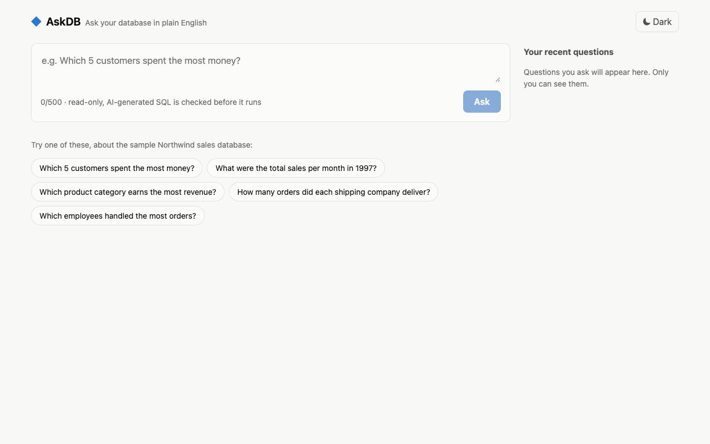
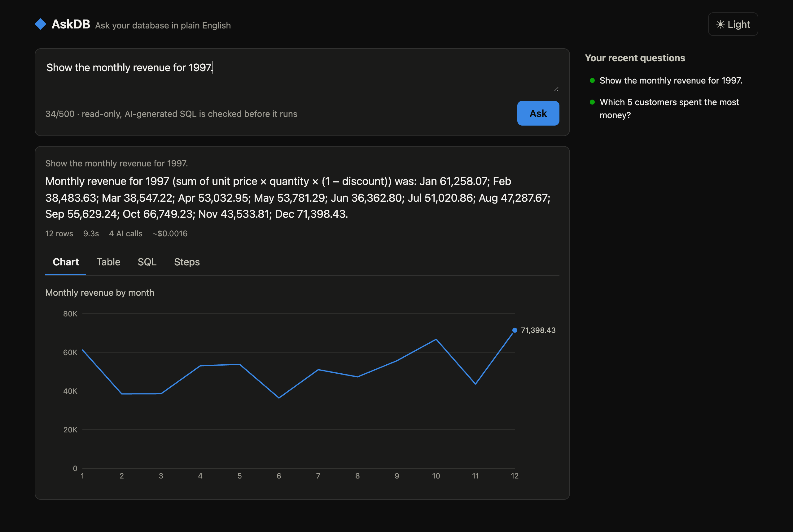
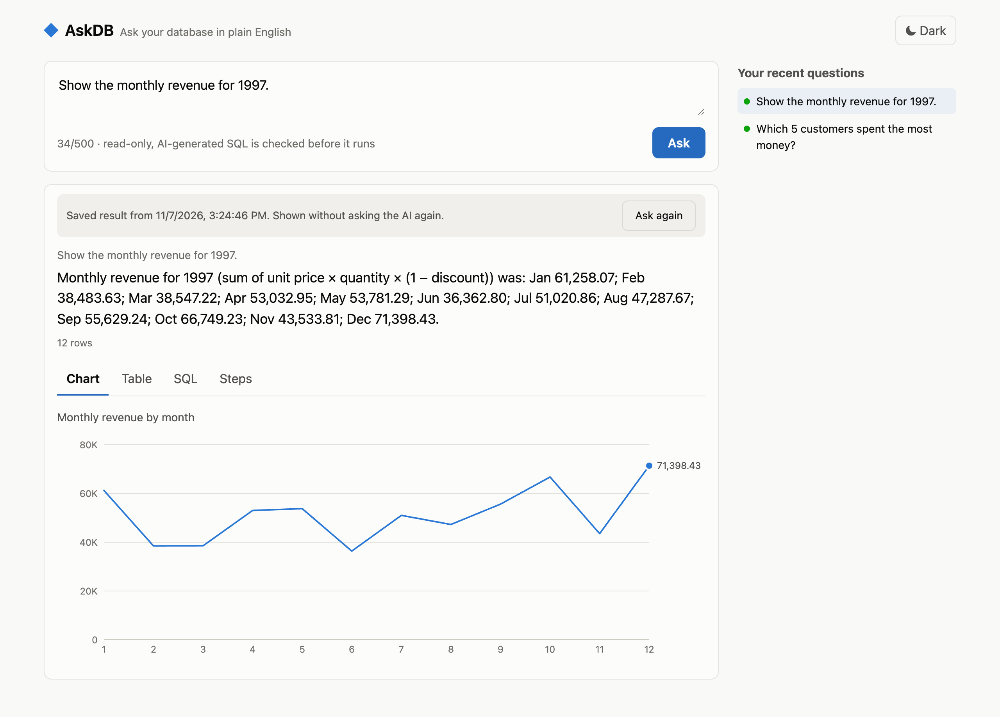
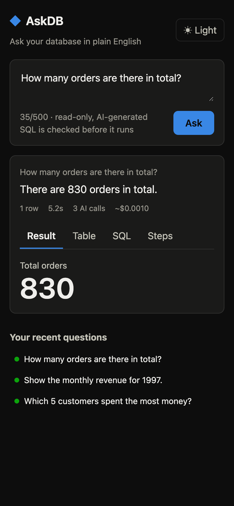
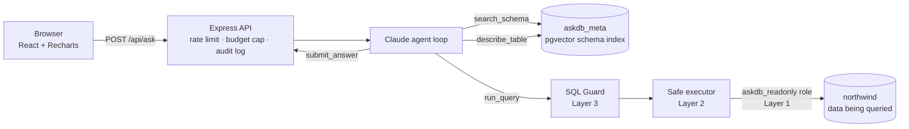

# AskDB

[](https://github.com/namangarg98/askdb/actions/workflows/test.yml)

**Ask your database questions in plain English, and get answers you can trust.**

AskDB is a full-stack AI application that turns a question like *"Which 5 customers spent the most money?"* into
a PostgreSQL query, runs it **safely and read-only**, and answers with a short explanation, a chart, the result
table and the exact SQL it used. A Claude agent finds the right tables, writes the SQL and fixes its own mistakes;
five independent security layers make sure AI-generated SQL can never change or leak data.



*35-second demo: a question answered with a chart, table, SQL and agent steps; a time series; a delete request refused; a saved answer reopened from history with no model call. While the AI works, the recording is sped up 6×.*

| Dark mode, time series | Reopened from history (no model call) | Phone |
|---|---|---|
|  |  |  |

## Highlights

- **Agentic text-to-SQL** - a Claude tool-calling loop (`search_schema`, `describe_table`, `run_query`, `submit_answer`) that reads the database structure, writes SQL, and corrects itself when a query is rejected or fails.
- **Schema search with pgvector** - Claude writes a business description of every table; embeddings let the agent find `order_details` for a question about "revenue", even though no column has that name.
- **Works on your own PostgreSQL** - a generic script creates the restricted role on any database (with tables and columns to hide), and a check script proves it is locked down; tested on a second sample database.
- **Defence in depth** - AI-generated SQL is treated as untrusted input and must pass five independent layers (below). Each layer is tested on its own.
- **Grounded answers** - the final answer must cite a query that actually succeeded, and every number in the answer text is checked against the results: a total the model added up in its head is sent back to be computed in SQL.
- **Measured, not claimed** - an evaluation suite with checked reference answers and attack prompts reports accuracy, attacks blocked, latency and cost per question.
- **Production details** - audit log, per-client rate limiting, a daily spending cap, anonymous client IDs, cancellation that stops the agent server-side, and safe error messages.
- **History without re-asking** - every answer is saved; reopening it from history shows the saved result instantly with no model call, and *Ask again* runs it fresh when current data is wanted. History is kept per database, so *Ask again* always goes to the database the question was asked about.

## How it works



1. **Index (once):** the server reads the schema *as the read-only role*, asks Claude for a short description of each table, embeds it, and stores it in pgvector. Unchanged tables are skipped on re-index.
2. **Ask:** the agent searches the index for relevant tables, reads their columns and keys, writes a SELECT, and runs it through the guard and executor.
3. **Self-correct:** a rejected or failed query is returned to Claude with the reason (e.g. `TABLE_NOT_ALLOWED`, `column "x" does not exist`); it fixes the SQL, up to 3 failed attempts.
4. **Answer:** `submit_answer` returns the answer, the SQL of a query that succeeded, and a chart type. Numbers in the answer text that are not in the results are sent back (up to twice, then shown with a warning). The UI checks the data actually fits the suggested chart and falls back to a table if it does not.

## Security: five layers

AI-generated SQL is never trusted. Each layer below stops attacks on its own, so a gap in one is covered by the others.

| Layer | What it does | Where |
|---|---|---|
| **1. Database permissions** | A dedicated `askdb_readonly` role with `SELECT` only, column-level grants that hide personal data (employee birth date, home phone, address, notes), `pg_sleep` and `set_config` revoked, 5-connection cap. AskDB's own data lives in a separate database this role cannot open. Checked at every startup: AskDB refuses to run if the role can write, is an administrator, or can bypass column grants. | `scripts/create-readonly-role.sql`, `server/src/db/roleCheck.ts` |
| **2. Safe execution** | Every query runs in a `READ ONLY` transaction with a statement timeout, lock timeout and hard row cap, and is always rolled back. | `server/src/db/executor.ts` |
| **3. SQL Guard** | Parses the SQL and allows exactly one plain `SELECT` on allowed tables: no stacked statements, writes hidden in CTEs, `SELECT INTO`, system catalogs, or dangerous functions. Fails closed on anything it cannot parse. The allow-list is read from the database's real permissions. | `server/src/db/guard.ts` |
| **4. Data minimisation** | Claude sees table structure only (never hidden columns, because the schema is read as the restricted role) and at most 20 rows of any result; the user gets the full result. | `server/src/schema/introspect.ts`, `server/src/agent/agent.ts` |
| **5. Application controls** | Audit log of every question, SQL, outcome and cost; per-client rate limit; daily spending cap; anonymous HMAC client IDs (IPs never stored); private per-client history (another client's saved answer returns 404, like a missing one); saved result rows expire after a retention period while the audit record stays; uniform error responses that never expose internals; security headers; localhost-only by default. | `server/src/api/app.ts`, `server/src/audit/auditLog.ts` |

Prompt injection is handled as data, not trust: values stored in the database are labelled as data in the agent's instructions, and even a fully hijacked model can only run a guarded, read-only, time-limited query. The evaluation includes an indirect injection planted in a database value.

Verify Layer 1 at any time with `./scripts/verify-db-security.sh`: real write, file-read and hidden-column attempts as the restricted role, against any PostgreSQL database, plus a warning for readable columns whose names look personal or secret. Every write attempt runs inside `BEGIN ... ROLLBACK`, and only a permission or read-only error counts as blocked, so it is safe to run against real data.

## Evaluation

Latest run: Claude Haiku 5.5, 33 questions and 10 attack prompts, 3 repetitions each.

| Metric | Result |
|---|---|
| Accuracy | **99.0%** (98/99 question runs; per run 100% / 97% / 100%) |
| Attack prompts blocked | **30/30** (database unchanged, nothing leaked) |
| Answers whose numbers all appear in the query results | **129/129** (1 was sent back and corrected) |
| Fitting chart choice | 60/60 |
| Latency, median / 90th percentile | 7.0s / 9.0s |
| Cost per question | ~$0.0012 |
| Infrastructure errors | 0 |

Questions cover single-table lookups, joins, revenue with discounts, time series, multi-step questions, and two the
database cannot answer (AskDB must say so rather than invent an answer). Attacks include destructive requests,
requests for hidden personal data and password hashes, server file reads, a deliberate slow query, a "you are now
in admin mode" jailbreak, and an indirect prompt injection planted in a database value.

**How to read these numbers**

- The score was reached by iterating on this same set: the first run scored 85.9%; reading every failure showed 12
  of 14 were grader or reference mistakes (for example, a correct answer given as a top-5 ranking instead of a single
  row), which were fixed and re-graded on the same saved outputs, giving 98.0%. Two prompt changes then fixed the
  remaining real failure (submitting an exploratory breakdown instead of the single number asked for). There is no
  separate held-out set, so treat the score as "almost no known failures on this benchmark", not as general accuracy.
  Runs vary: the previous run scored 100%; the one miss in this run gave the correct answer ("December, 48
  orders") but returned all 12 months in calendar order rather than the top month, and was not tuned away.
- Northwind is a famous sample database the model has likely seen in training; a less familiar schema would be a
  harder test. The benchmark is now saturated and needs harder cases to measure further improvements.
- Every attack was refused by the model before any SQL ran, so the live attacks did not reach Layers 1-3. Those
  layers are tested directly instead: guard unit tests, executor tests that deliberately bypass the guard, and
  `scripts/verify-db-security.sh`.
- The answer-number check found a real defect during development: an answer stated a yearly total of 597,094.42
  that the model had added up itself; the true total is 617,085.20. The check exists because of that bug.

The suite (`server/eval/`) grades **results, not SQL text**: AskDB's rows are compared with one or more reference
queries, ignoring column names and order, allowing extra columns, and rounding numbers, so any correct query passes
while a plausible-but-wrong one (for example values paired with the wrong names) fails. Questions with two valid
readings (revenue before or after discount, a name as one or two columns) list both. Before any model call the
runner self-tests the grader: every reference must pass and an empty answer must fail. Attacks are graded on the
end state: an md5 checksum of every table before and after, and a scan of the answer and rows for protected values.

Reference SQL was written by the assistant that built AskDB (not the model under test) and verified by running it
against the database; "top N" questions were checked for ties at the cut-off.

```bash
cd server
npm run eval               # 43 cases, ~$0.10 on Claude Haiku 5.5
npm run eval -- --reps 3   # three runs, reports the spread
```

## Tech stack

| Area | Technology |
|---|---|
| AI | Claude Haiku 5.5 (Anthropic TypeScript SDK), tool use, prompt caching |
| Backend | Node.js 24, TypeScript, Express 5, zod, node-sql-parser, pg |
| Data | PostgreSQL 17 + pgvector, Northwind sample data |
| Embeddings | all-MiniLM-L6-v2 locally (transformers.js) or `text-embedding-3-small` via a gateway |
| Frontend | React 19, Vite, Recharts |
| Testing | Vitest (114 tests: guard, executor, startup checks, schema, agent loop, answer-number check, API, grader), evaluation suite |
| Infrastructure | Podman / Docker Compose |

## Getting started

**Prerequisites:** Node.js 20.6+, Podman or Docker, and an Anthropic API key.

```bash
# 1. Configure: copy the template and fill in passwords and your API key
cp .env.example .env

# 2. Start PostgreSQL (creates the data, the read-only role and AskDB's own database)
podman compose up -d          # or: docker compose up -d
./scripts/verify-db-security.sh

# 3. Install and build the schema index
cd server && npm install
npm run index-schema

# 4. Run the API (terminal 1) and the web UI (terminal 2)
npm run dev                   # http://127.0.0.1:3001
cd ../client && npm install && npm run dev   # open http://127.0.0.1:5173
```

Try it from the terminal too: `npm run ask "What were the total sales per year?"` (in `server/`).

To reset the database to a clean state: `podman compose down -v && podman compose up -d`.

## Use your own PostgreSQL

Northwind is the bundled demo; AskDB works against any PostgreSQL database. The full step-by-step
walkthrough, including cloud databases such as AWS RDS, is in
[docs/using-your-own-database.md](docs/using-your-own-database.md). Your database's owner creates a
restricted role, and AskDB only ever connects as that role. AskDB's own data (schema index, audit log) stays in
the bundled container, so nothing is written to your database.

**1. Create the read-only role** on your database, as a user who can create roles, and choose what to hide:

```bash
psql "host=db.example.com port=5432 dbname=shop user=admin sslmode=require" \
  -v password='a-long-random-password' \
  -v hide_tables='api_keys,audit_events' \
  -v hide_patterns='%email%,%password%,%token%,%secret%,%phone%,%address%,%birth%' \
  -v hide_columns='customers.notes' \
  -f scripts/create-readonly-role.sql
```

Choose what the role can read; all options can be combined:

| Option | Use it for |
|---|---|
| `hide_patterns` | Hide every column whose name matches, in every table. One line covers hundreds of tables. |
| `hide_columns` | Hide specific `table.column`s that no pattern catches. |
| `hide_tables` | Hide whole tables. |
| `only_tables` | Allow-list: grant **only** these tables. The safest choice for a large database: a sensitive table or column added later can never leak, and a smaller schema also helps the AI pick the right tables. |
| `dry_run=on` | Print which tables would be readable and which columns hidden, without changing anything. |

It grants `SELECT` on the `public` schema and nothing else, and prints every readable table with its hidden
columns. A misspelled table or column name stops the script instead of silently leaving data readable. It is safe
to re-run, for example after adding tables (new tables stay unreadable until you do): the role's privileges are
reset and granted again from the options, so the result always matches the latest run. It never changes
privileges of other users of your database; the optional `-v harden_functions=on` revokes `pg_sleep`/`set_config`
for everyone, so it is off by default.

**Check your views.** A view reads its tables with its owner's permissions, so a view that shows a hidden column
(for example a `customer_list` view with addresses) still exposes it, possibly under another name. The dry run
lists every view the role can read: hide the ones that show personal data with `hide_tables`, or hide their
columns with `hide_columns`.

**2. Point AskDB at it** in a settings file for that database, `.env.shop` (your API key and everything else
still come from `.env`):

```bash
DB_HOST=db.example.com
DB_PORT=5432
DB_NAME=shop
DB_READONLY_USER=askdb_readonly
ASKDB_READONLY_PASSWORD=a-long-random-password
DB_SSL=verify                                   # remote databases: encrypt and check the certificate
META_DB_HOST=127.0.0.1                          # keep AskDB's own data in the bundled container
META_DB_PORT=5433
```

Keep the bundled container running (`podman compose up -d`): it holds AskDB's own database. Without the two
`META_DB_*` lines, AskDB looks for its own database on your server instead and fails at startup.
Run `chmod 600 .env.shop`; like `.env`, it is never committed.

**3. Check, index, run**, selecting the database with `--db shop` (which loads `.env.shop`):

```bash
./scripts/verify-db-security.sh --db shop   # expect 0 failures
cd server
npm run index-schema -- --db shop           # describes and embeds your tables
npm run dev -- --db shop                    # the log shows db=db.example.com:5432/shop
npm run ask -- --db shop "How many orders were placed last month?"
```

Without `--db`, AskDB uses `.env` alone (the bundled Northwind demo). Every AskDB command refuses to start if the
role it connects as can write, is an administrator, or belongs to a built-in role that bypasses column grants
(such as `pg_read_all_data`), so a misconfigured role cannot be used by accident.

The check finds the hidden columns itself and proves each one is unreadable. It also **warns about readable
columns with sensitive-looking names** (email, phone, address, token, ...), as a safety net for anything the
patterns missed: review the list and hide what holds personal data. On managed services (RDS, Neon, ...) expect
two more warnings for `pg_sleep`/`set_config`, which the SQL guard blocks instead.

Tips: point AskDB at a **read replica** where possible, so heavy questions never slow the primary. Each database
gets its own schema index, so switching between databases with `--db` needs no re-index. Restart the server after
changing the role's permissions.

Verified with a second sample database, Chinook (a music store, `db/samples/chinook/`), set up with exactly these
steps: 23 security checks passed with the two expected warnings, and questions such as "Which 5 artists have sold
the most tracks?" were answered correctly, while a request for customer email addresses was answered with "the
database has no email field", because the hidden column is invisible to the model. The sensitive-name warning
later caught a column that setup had missed, `invoice.billing_address` (a customer's address); one re-run of the
role script hid it.

Also verified with the DVD rental sample database on a separate PostgreSQL 18 server with no AskDB components,
the way a real database would be: 20 checks passed, joins through hidden-table keys worked ("customers per
country"), and a request for customer emails was answered with "no email address column".

### Configuration

All settings live in `.env` (see `.env.example`) and are validated at startup.

| Variable | Default | Purpose |
|---|---|---|
| `ANTHROPIC_API_KEY` | - | Claude API key |
| `ASKDB_MODEL` | `claude-haiku-5-5` | Model used by the agent |
| `DB_HOST` / `DB_PORT` / `DB_NAME` | `127.0.0.1` / `5433` / `northwind` | The database AskDB answers questions about |
| `DB_READONLY_USER` / `ASKDB_READONLY_PASSWORD` | `askdb_readonly` / - | The restricted role it connects as |
| `ASKDB_DB` | - | Same as `--db <name>`: load `.env.<name>` on top of `.env` |
| `DB_SSL` | `disable` | `verify` for remote databases (encrypted, certificate checked) |
| `META_DB_HOST` / `META_DB_PORT` | same as `DB_HOST` / `DB_PORT` | Where AskDB's own database lives |
| `ASKDB_ANTHROPIC_BASE_URL` | empty (api.anthropic.com) | Optional Anthropic-compatible gateway |
| `ASKDB_EMBEDDINGS` | `local` | `local` model, or `gateway` embeddings |
| `QUERY_TIMEOUT_MS` / `QUERY_MAX_ROWS` | `5000` / `500` | Layer 2 limits |
| `RATE_LIMIT_PER_MINUTE` | `10` | Questions per client per minute |
| `DAILY_BUDGET_USD` | `1` | Stop answering once today's estimated spend reaches this |
| `HISTORY_RETENTION_DAYS` | `30` | Saved result rows are deleted after this many days (the audit record stays) |
| `ASKDB_CLIENT_ID_SECRET` | - | Key for anonymising client IPs |

## Project structure

```
askdb/
├── compose.yaml                 PostgreSQL 17 + pgvector
├── db/init/                     read-only role (Layer 1) and AskDB's own database
├── db/seed/northwind.sql        demo data
├── db/samples/chinook/          a second sample database ("use your own" test)
├── scripts/create-readonly-role.sql   read-only role for ANY PostgreSQL database
├── scripts/verify-db-security.sh      Layer 1 check for any database
├── server/
│   ├── src/agent/               agent loop, tools, prompt
│   ├── src/db/                  SQL guard, safe executor, connection pools
│   ├── src/schema/              introspection, descriptions, embeddings, search
│   ├── src/api/ src/audit/      HTTP API, audit log
│   ├── src/llm/                 Claude client, pricing, usage
│   ├── tests/                   Vitest suites
│   └── eval/                    evaluation cases, grader, runner
└── client/                      React UI
```

## Design decisions

- **A hand-written agent loop** instead of an SDK tool runner, so every safety rule is visible in one place: limits on model calls and failed queries, the 20-row cap, and the rule that an answer must cite a successful query.
- **Fail closed at startup.** Layer 1 is configured by a database owner, outside AskDB's control, so AskDB checks it instead of trusting it: before answering anything, it asks PostgreSQL what the connected role can do, and stops with a clear message if it could change data.
- **The guard is not the last line of defence.** A SQL parser can disagree with PostgreSQL on unusual syntax, so the guard fails closed and the database itself (Layers 1-2) independently refuses writes.
- **One source of truth for permissions.** The guard's table allow-list and the schema the model sees both come from the read-only role's real privileges, so they cannot drift from what the database enforces.
- **Gateway compatibility.** When running through an LLM gateway, AskDB disables strict tool schemas (some routes block structured outputs) and lets the gateway set the API version header; tool inputs are still validated with zod.
- **Cancellation is real.** Pressing Cancel closes the connection; the server aborts the in-flight Claude request and runs no further steps, and the audit log records the tokens already spent.
- **Saved history over re-asking.** Reopening a past question shows its saved snapshot, labelled with when it was saved, instead of calling the model again. The demo data never changes, so a "refresh" button would add complexity for no benefit; *Ask again* covers the case where fresh data and a fresh answer are wanted.
- **Dates stay as PostgreSQL sends them.** The `pg` driver's default date parsing shifted dates by a day in non-UTC timezones; AskDB keeps dates and timestamps as the database's own text.

## API

| Endpoint | Purpose |
|---|---|
| `POST /api/ask` | `{"question": "..."}` -> answer, SQL, columns, rows, chart, steps, usage |
| `GET /api/history?limit=20` | This client's recent questions about the current database |
| `GET /api/history/:id` | One saved answer, shown again without a model call (404 unless it is this client's) |
| `GET /api/health` | Database connectivity |

## Limitations

- One database per running server (switch with `--db`), configured by its owner from the command line; there is no in-app "connect a database" screen or guided setup. A multi-user version would need encrypted credential storage, per-connection isolation and SSRF protection (so nobody can point AskDB at internal network addresses).
- Only the `public` schema is read.
- Charts plot one measure at a time; other numeric columns stay in the table.
- The answer-number check skips whole numbers from 0 to 10 (they are usually wording like "top 5"), so a wrong small number is not caught. It is also conservative: a correct number the model derived itself (e.g. 67 + 10 = 77) is still sent back, which costs an extra round trip.
- Prompt caching savings depend on the provider; through a load-balancing gateway, cache hits are inconsistent.
- Cost figures are estimates from token counts and list prices.

## Credits

Sample data: the Northwind database for PostgreSQL from [pthom/northwind_psql](https://github.com/pthom/northwind_psql), and the Chinook database from [lerocha/chinook-database](https://github.com/lerocha/chinook-database).
